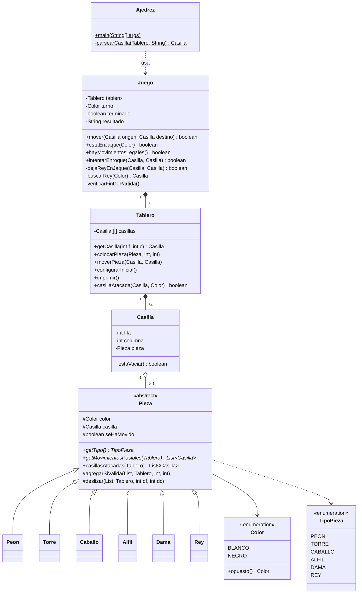

# Avance del proyecto integrador — Corte II

**Diseño y Programación Orientados a Objetos** · Universidad Católica de Colombia · 2026-3
Profesor: Juan Carlos Navarro · Avance presentado el jueves 15 de octubre de 2026

| Integrante | Código |
|---|---|
| Juan José Betancourt | 67001968 |
| Santiago Suárez Alfonso | 67001862 |

---

## 1. Qué se tiene hasta ahora

Un ajedrez para **dos jugadores en consola**, en Java. El tablero se imprime después de cada jugada
y cada jugador escribe su movimiento como casilla de origen y casilla de destino (`e2 e4`).

| Regla | Estado |
|---|---|
| Tablero de 8×8 con la posición inicial | ✅ |
| Movimiento de las seis piezas | ✅ |
| Turnos alternados (empiezan las blancas) | ✅ |
| No se puede mover a una casilla con pieza propia | ✅ |
| Captura de piezas rivales | ✅ |
| Las piezas que se deslizan (torre, alfil, dama) no saltan piezas | ✅ |
| Doble paso inicial del peón | ✅ |
| Jaque, y prohibición de jugadas que dejen al propio rey en jaque | ✅ |
| Jaque mate (fin de la partida) | ✅ |
| Rey ahogado (tablas) | ✅ |
| Enroque corto y largo, con todas sus condiciones | ✅ |
| Coronación del peón | ⬜ pendiente |
| Captura al paso | ⬜ pendiente |
| Demás tipos de tablas (50 movimientos, triple repetición, material insuficiente, acuerdo) | ⬜ pendiente |

## 2. Diagrama de clases

### Cómo se leen las relaciones

- **Tablero → Casilla es composición.** El tablero crea sus 64 casillas en el constructor y no
  existen fuera de él: si se destruye el tablero, se destruyen las casillas.
- **Casilla → Pieza es agregación.** La pieza se crea aparte (`new Torre(Color.NEGRO)`) y después
  se coloca en la casilla. Puede cambiar de casilla o salir del tablero cuando la capturan, y sigue
  existiendo como objeto.
- **Pieza → sus seis subclases es herencia.** Todo lo que comparten las piezas (color, casilla,
  si ya se movió) está una sola vez en `Pieza`.

## 3. Conceptos de POO aplicados

| Concepto | Dónde está |
|---|---|
| **Clase abstracta** | `Pieza`: no se puede crear una "pieza" genérica, solo un peón, una torre, etc. Obliga a cada subclase a implementar `getTipo()` y `getMovimientosPosibles()`. |
| **Herencia** | `Peon`, `Torre`, `Caballo`, `Alfil`, `Dama` y `Rey` extienden `Pieza`. |
| **Polimorfismo** | `Juego` le pide a cualquier pieza `getMovimientosPosibles(tablero)` sin saber qué pieza es; cada subclase responde a su manera. Lo mismo con `casillasAtacadas()`, que solo el `Peon` sobrescribe, porque es la única pieza que no ataca igual a como se mueve. |
| **Encapsulamiento** | Atributos `private` (en `Casilla`, `Tablero`, `Juego`) o `protected` (en `Pieza`, para las subclases), con acceso por métodos. El arreglo de casillas no se entrega completo: solo `getCasilla(f, c)`. |
| **Abstracción** | Cada clase representa un concepto del dominio del ajedrez descrito en el documento del corte I: tablero, casilla, pieza, partida. |
| **Reutilización** | `deslizar()` y `agregarSiValida()` se escriben una vez en `Pieza`. La torre, el alfil y la dama usan `deslizar()` con distintas direcciones; el caballo y el rey usan `agregarSiValida()` con distintos saltos. |

## 4. Cómo se valida un movimiento

Es la misma idea de los vectores (Δfila, Δcolumna) del documento del corte I. En la matriz, la fila
0 es la fila 8 del tablero y la fila 7 es la fila 1. Por eso las blancas avanzan restando filas.

| Pieza | Vectores | Cómo los recorre |
|---|---|---|
| Torre | (±1, 0), (0, ±1) | `deslizar`: avanza en esa dirección hasta encontrar el borde o una pieza |
| Alfil | (±1, ±1) | `deslizar` |
| Dama | las 8 direcciones | `deslizar` |
| Caballo | (±2, ±1), (±1, ±2) | `agregarSiValida`: un solo salto, puede pasar por encima de piezas |
| Rey | las 8 direcciones, un paso | `agregarSiValida` |
| Peón | blanco Δf = −1, negro Δf = +1 | avanza solo si la casilla está vacía; doble paso desde su fila inicial; captura solo en diagonal |

`Juego.mover()` decide si una jugada es legal en este orden:

1. Hay una pieza en el origen y es del jugador en turno.
2. Si es un enroque, lo valida y lo hace aparte (`intentarEnroque`).
3. El destino está entre los `getMovimientosPosibles()` de la pieza. Ahí ya queda descartado
   mover a una casilla propia, y una casilla rival cuenta como captura.
4. **La jugada no deja al propio rey en jaque.** `dejaReyEnJaque()` hace el movimiento en el
   tablero, revisa si el rey quedó atacado y lo deshace exactamente como estaba (piezas, casillas
   y la marca de "ya se movió").
5. Si pasa todo, se mueve, cambia el turno y se revisa si la partida terminó: sin jugadas legales
   y en jaque → **jaque mate**; sin jugadas legales y sin jaque → **ahogado**.

## 5. Cómo probarlo

En NetBeans: *Open Project* → esta carpeta → *Run*. Algunas partidas cortas para comprobar las reglas:

| Qué se prueba | Jugadas |
|---|---|
| Jaque mate (mate del pastor) | `e2 e4` · `e7 e5` · `f1 c4` · `b8 c6` · `d1 h5` · `g8 f6` · `h5 f7` |
| Enroque corto de blancas y largo de negras | `e2 e4` · `d7 d5` · `g1 f3` · `b8 c6` · `f1 c4` · `c8 f5` · `e1 g1` · `d8 d7` · `a2 a3` · `e8 c8` |
| Movimientos ilegales | `a1 a4` (la torre no salta) · `e1 e2` (casilla propia) |

## 6. Lo que sigue para la entrega del corte

1. **Coronación del peón**: al llegar a la última fila, el jugador escoge dama, torre, alfil o caballo.
2. **Captura al paso**.
3. **Interfaces**: aún no se usa ninguna interfaz de Java; se va a agregar donde tenga sentido en
   el diseño.
4. **Los demás tipos de tablas** descritos en el documento del corte I.
5. **Separar en paquetes** `mundo` (la lógica) e `interfaz` (la consola), como se vio en clase.
6. Quitar los mensajes de depuración que todavía imprime el enroque.
7. Las correcciones al documento del corte I.
